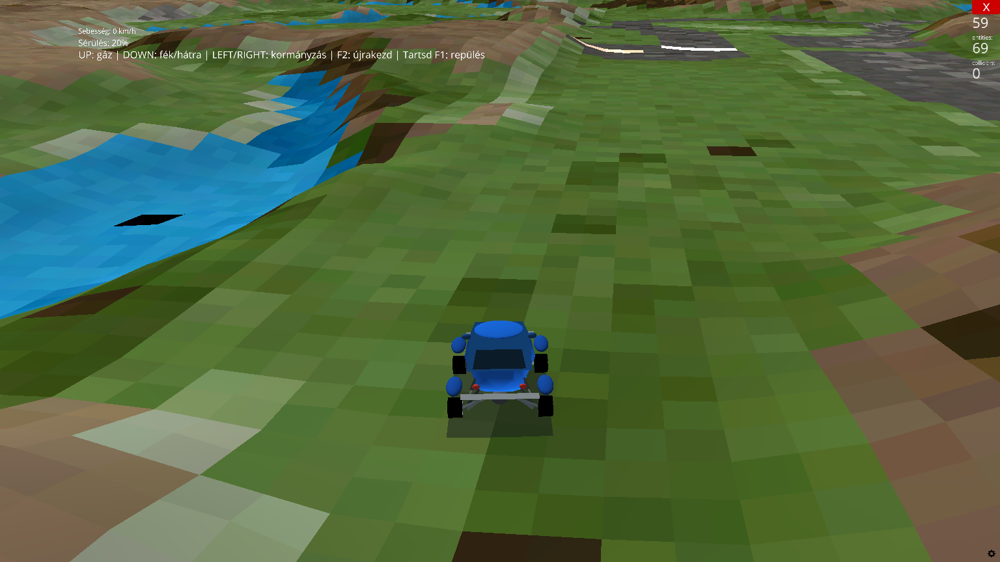

# Terep3

This is a Python re-implementation of Terep2, a historically very significant and excellent program.

Huge respect to the original creator:
[Terep 2 wikipediea](https://hu.wikipedia.org/wiki/Terep_2).


A picture of the current program:



## Install and run

Install [uv](https://docs.astral.sh/uv/), then run these commands from the
project directory:

```powershell
uv sync
uv run python terep3.py
```

The project requires Python 3.11 or newer. `uv sync` installs the runtime
dependencies and uses `uv.lock` to keep dependency versions reproducible.
Place `COL-CLASSIC.png` next to `terep3.py` before running; the game uses it to
generate the terrain.


